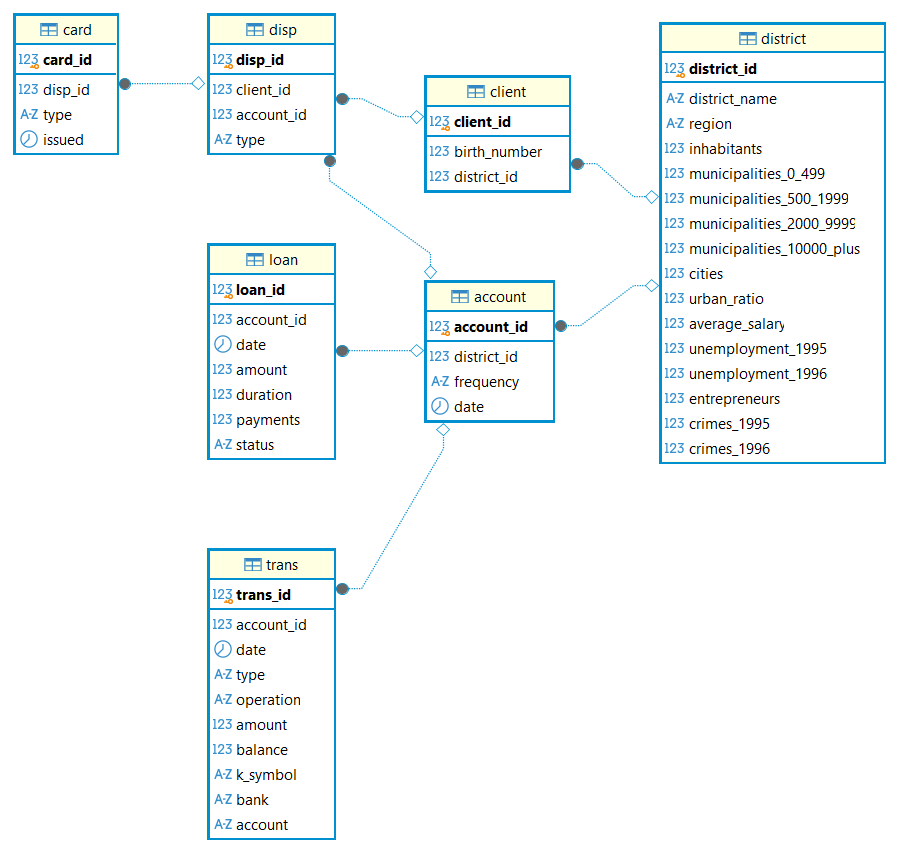
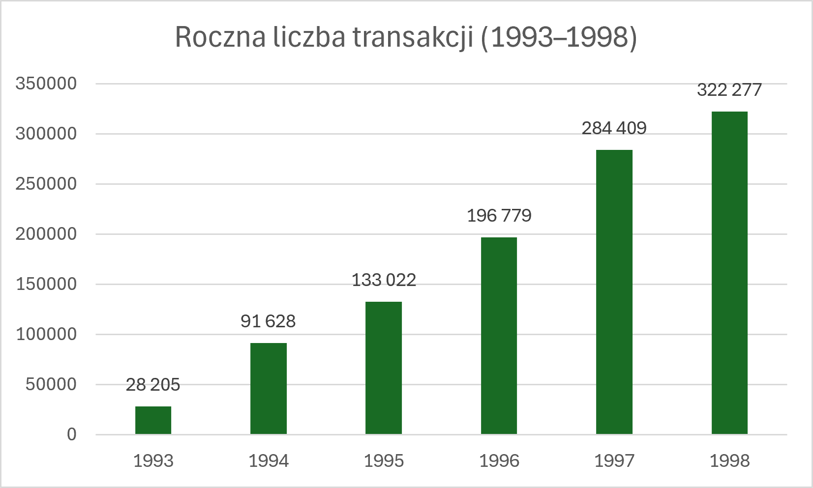
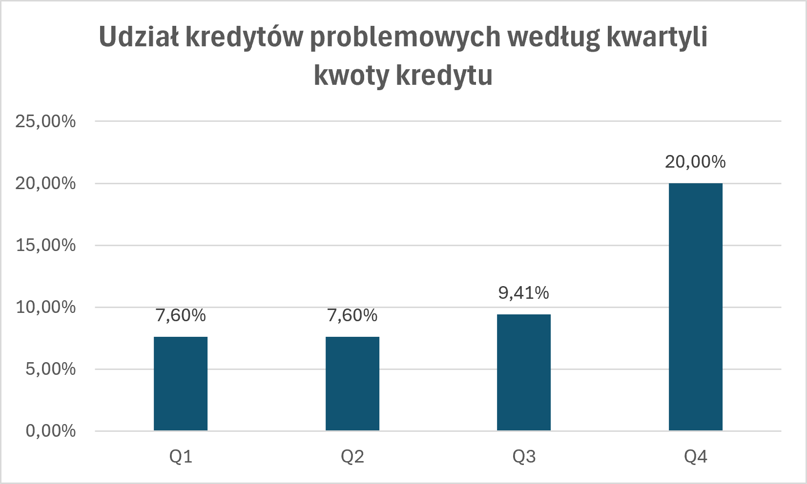

# Analiza danych bankowych | SQL & PostgreSQL

## O projekcie

Projekt przedstawia analizę danych bankowych z wykorzystaniem języka SQL oraz systemu PostgreSQL.

Celem projektu jest zbadanie działalności banku na podstawie informacji o klientach, rachunkach, transakcjach finansowych i kredytach. Analiza koncentruje się na identyfikacji trendów transakcyjnych, ocenie aktywności klientów, analizie czynników związanych z problemami w spłacie kredytów oraz porównaniu działalności bankowej w poszczególnych regionach.

Projekt bazuje na rzeczywistych, zanonimizowanych danych historycznych czeskiego banku z lat 1993–1998.

## Cele analizy

Projekt obejmuje cztery główne obszary analityczne:

1. **Analiza transakcji** – badanie przepływów finansowych, trendów, sezonowości oraz aktywności rachunków bankowych.
2. **Analiza klientów** – ocena aktywności klientów, struktury rachunków oraz wykorzystania produktów bankowych.
3. **Analiza kredytów** – ocena portfela kredytowego, statusów spłaty oraz czynników powiązanych z problemami kredytowymi.
4. **Analiza regionalna** – porównanie działalności bankowej w poszczególnych regionach oraz analiza wybranych wskaźników ekonomicznych.

## Zbiór danych

W projekcie wykorzystano **Berka Dataset (PKDD'99)** – rzeczywisty, zanonimizowany zbiór historycznych danych czeskiego banku z lat 1993–1998.

Źródło: [Berka Dataset – GitHub](https://github.com/jlacko/berka-dataset)

Po zaimportowaniu danych do PostgreSQL baza zawiera osiem powiązanych tabel:

| Tabela | Opis | Liczba rekordów |
|---|---|---:|
| `client` | Dane klientów banku | 5 369 |
| `account` | Rachunki bankowe | 4 500 |
| `disp` | Powiązania klientów z rachunkami | 5 369 |
| `district` | Dane demograficzne i ekonomiczne regionów | 77 |
| `card` | Karty bankowe | 892 |
| `loan` | Kredyty bankowe | 682 |
| `payment_order` | Stałe zlecenia płatnicze | 6 471 |
| `trans` | Transakcje bankowe | 1 056 320 |

## Model bazy danych

Baza składa się z ośmiu powiązanych tabel, umożliwiających analizę klientów, rachunków, transakcji oraz kredytów.

Poniższy diagram ERD przedstawia strukturę bazy danych i relacje między tabelami.



## Przygotowanie danych

Przed rozpoczęciem analizy przeprowadzono proces przygotowania danych (ETL), obejmujący:

1. Import oryginalnych plików `.asc` do tabel pomocniczych (*staging*).
2. Weryfikację liczby rekordów, unikalności identyfikatorów oraz brakujących wartości.
3. Konwersję typów danych, w tym dat i wartości liczbowych.
4. Obsługę brakujących wartości z wykorzystaniem `NULL`.
5. Przeniesienie przekształconych danych do tabel docelowych.
6. Kontrolę integralności referencyjnej między tabelami.
7. Utworzenie 8 kluczy obcych i 9 dodatkowych indeksów.

Wszystkie osiem tabel zostało poprawnie zaimportowanych do PostgreSQL.

## Podstawowe wskaźniki KPI

Analiza objęła dane dotyczące działalności banku w latach 1993–1998.

| Wskaźnik | Wartość |
|---|---:|
| Liczba klientów | 5 369 |
| Liczba rachunków bankowych | 4 500 |
| Liczba transakcji | 1 056 320 |
| Liczba kredytów | 682 |
| Liczba kart bankowych | 892 |
| Liczba stałych zleceń płatniczych | 6 471 |

Wskaźniki te przedstawiają skalę analizowanego zbioru danych i stanowią punkt wyjścia do dalszej analizy aktywności klientów, przepływów finansowych oraz wykorzystania produktów bankowych.

## Najważniejsze wyniki i wnioski biznesowe

Na podstawie przeprowadzonych analiz SQL zidentyfikowano następujące zależności:

**1. Dodatni przepływ netto na rachunkach klientów**

Łączna wartość wpływów wyniosła 3,23 mld CZK, a wypływów 3,03 mld CZK. Przepływ netto w analizowanym okresie był dodatni i wyniósł **197,15 mln CZK**. Wskaźnik ten nie oznacza zysku banku.

**2. Wyraźna sezonowość przepływów finansowych**

Styczeń charakteryzował się najniższym średnim miesięcznym przepływem netto (**−15,30 mln CZK**), natomiast luty najwyższym (**+11,21 mln CZK**). Zwiększone styczniowe wypłaty były istotnym czynnikiem związanym z ujemnym przepływem netto.

**3. Większa aktywność rachunków powiązanych z kredytami**

Właściciele rachunków z kredytem wykonywali średnio **280,87 transakcji**, wobec **226,50** w grupie bez kredytu – różnica wynosi około 24%. Zależność ma charakter opisowy i nie dowodzi, że posiadanie kredytu zwiększa aktywność.

**4. Większe kwoty kredytów powiązane z częstszymi problemami ze spłatą**

Kredyty problemowe stanowiły **11,14%** wszystkich kredytów. W grupie 25% kredytów o najwyższych kwotach udział problemowych wynosił **20,00%**, wobec **7,60%** w grupie najniższych kwot.

**5. Duża koncentracja działalności bankowej w Pradze**

Praga odpowiadała za **12,35% klientów**, **12,16% rachunków** i **129 346 transakcji**. Jednocześnie średnia aktywność pojedynczego rachunku była wyższa w Ostrava - mesto niż w Pradze.

**6. Zróżnicowanie regionalne problemów kredytowych**

Udział kredytów problemowych różnił się między regionami. Przykładowo w Svitavach wynosił **25,00%** (3 z 12 kredytów), a w Pradze **7,59%** (6 z 79 kredytów). Porównanie z regionalnym bezrobociem i wynagrodzeniami nie wykazało jednoznacznego wzorca.

**Podsumowanie:** Analiza pozwoliła zidentyfikować istotne różnice w aktywności klientów, sezonowości przepływów finansowych i strukturze portfela kredytowego. Wyniki mają charakter opisowy i mogą stanowić punkt wyjścia do dalszych analiz biznesowych.

Szczegółowe wyniki, zestawienia danych oraz interpretacje biznesowe przedstawiono w dokumencie [`Analiza SQL – szczegółowe wyniki`](docs/analiza_sql.md). Wszystkie zapytania wykorzystane w projekcie znajdują się w katalogu [`sql/`](sql/).

## Wizualizacje wyników

Na podstawie wyników zapytań SQL przygotowano w Microsoft Excel dwa wykresy przedstawiające wybrane zależności dotyczące aktywności transakcyjnej oraz portfela kredytowego.

**Roczna liczba transakcji (1993–1998)**



W latach 1993–1998 roczna liczba transakcji wzrosła z 28 205 do 322 277. Największą dynamikę wzrostu odnotowano w 1994 roku (+224,86%). Wzrost liczby operacji był związany ze zwiększaniem liczby aktywnych rachunków, natomiast w 1998 roku zaobserwowano również wzrost średniej liczby transakcji przypadających na aktywny rachunek.

**Udział kredytów problemowych według kwartyli kwoty kredytu**



W grupie 25% kredytów o najwyższych kwotach udział kredytów problemowych wynosił 20,00%, wobec 7,60% w grupie o najniższych kwotach. Oznacza to ponad 2,6-krotnie wyższy odsetek kredytów problemowych w najwyższym kwartylu. Wynik wskazuje na zależność pomiędzy pierwotną wartością kredytu a występowaniem problemów ze spłatą, jednak nie dowodzi związku przyczynowego.

## Wyniki analiz w formacie CSV

W folderze [`results/`](results/) udostępniono wybrane, zagregowane wyniki zapytań SQL. Pozwalają one zapoznać się z rezultatami analiz bez konieczności uruchamiania bazy PostgreSQL.

| Plik | Zawartość |
|---|---|
| [`transaction_trends.csv`](results/transaction_trends.csv) | Roczna liczba i wartość transakcji oraz dynamika zmian rok do roku (YoY). |
| [`customer_segments.csv`](results/customer_segments.csv) | Segmentacja klientów według posiadania karty i kredytu. |
| [`loan_risk.csv`](results/loan_risk.csv) | Analiza udziału kredytów problemowych według kwartyli kwoty kredytu. |
| [`regional_analysis.csv`](results/regional_analysis.csv) | Zestawienie 10 regionów z największą liczbą transakcji i średnią aktywnością rachunków. |

Wszystkie pliki CSV zawierają nagłówki kolumn i wykorzystują przecinek jako separator pól oraz kodowanie UTF-8.

## Wykorzystane technologie

- **SQL** – przygotowanie danych, kontrola jakości oraz analiza biznesowa.
- **PostgreSQL** – przechowywanie i zarządzanie relacyjną bazą danych.
- **DBeaver** – import danych, zarządzanie bazą i wykonywanie zapytań SQL.
- **Microsoft Excel** – przygotowanie wykresów na podstawie wyników analiz SQL.
- **Visual Studio Code** – tworzenie i organizacja skryptów SQL oraz dokumentacji projektu.
- **Git / GitHub** – kontrola wersji i prezentacja projektu.

## Wykorzystane techniki SQL

Podczas przygotowania danych i przeprowadzania analiz biznesowych wykorzystano m.in.:

- **JOIN, LEFT JOIN** – łączenie danych z powiązanych tabel relacyjnych.
- **GROUP BY, HAVING** – grupowanie danych i filtrowanie wyników agregacji.
- **COUNT(), SUM(), AVG(), MIN(), MAX()** – obliczanie wskaźników i statystyk.
- **CASE WHEN, FILTER (WHERE ...)** – klasyfikacja danych i agregacja warunkowa.
- **CTE (WITH)** – tworzenie wieloetapowych zapytań analitycznych.
- **Funkcje okna** – `LAG()`, `NTILE()`, `ROW_NUMBER()` oraz agregacje z `OVER()` do analizy trendów, rankingów i udziałów procentowych.
- **PERCENTILE_CONT()** – obliczanie mediany liczby transakcji.
- **DATE_TRUNC(), EXTRACT()** – analiza trendów i sezonowości.
- **NULLIF(), COALESCE()** – obsługa wartości NULL i zabezpieczanie obliczeń.
- **Podzapytania i EXISTS** – wykonywanie obliczeń oraz sprawdzanie powiązań pomiędzy danymi.

Pełne zapytania SQL znajdują się w katalogu [`sql/`](sql/), a ich wyniki i interpretacje w dokumencie [`Szczegółowa analiza SQL`](docs/analiza_sql.md).

## Struktura projektu

```text
├── data/
│   └── raw/                      # Oryginalne dane bankowe (.asc)
├── docs/
│   ├── analiza_sql.md            # Szczegółowe wyniki analiz SQL
│   ├── banking_erd.png           # Diagram ERD bazy danych
│   ├── loan_risk.png             # Wykres analizy kredytów
│   └── transaction_trends.png    # Wykres trendów transakcyjnych
├── results/
│   ├── customer_segments.csv     # Segmentacja klientów
│   ├── loan_risk.csv             # Analiza kredytów problemowych
│   ├── regional_analysis.csv     # Analiza regionalna
│   └── transaction_trends.csv    # Trendy transakcyjne
├── sql/
│   ├── 01_create_tables.sql
│   ├── 02_create_staging_tables.sql
│   ├── 03_data_quality.sql
│   ├── 04_load_data.sql
│   ├── 05_foreign_keys.sql
│   ├── 06_create_indexes.sql
│   ├── 07_business_kpis.sql
│   ├── 08_transaction_analysis.sql
│   ├── 09_customer_analysis.sql
│   ├── 10_loan_analysis.sql
│   └── 11_regional_analysis.sql
├── .gitignore
└── README.md
```

## Instrukcja uruchomienia

### Wymagania

Do samodzielnego odtworzenia projektu potrzebne są:

- **PostgreSQL** – zainstalowany i uruchomiony serwer bazy danych.
- **DBeaver** – narzędzie do połączenia z PostgreSQL, importowania danych i uruchamiania skryptów SQL.
- **Pliki źródłowe** – osiem plików `.asc` dostępnych w katalogu `data/raw/`.

Do przeglądania gotowych wyników w katalogu `results/` oraz wykresów w `docs/` nie jest wymagane uruchomienie bazy danych.

### 1. Utworzenie bazy danych

1. Uruchom PostgreSQL oraz DBeaver.
2. W DBeaver utwórz połączenie z serwerem PostgreSQL, podając odpowiednie dane dostępowe.
3. Utwórz nową, pustą bazę danych, np. `banking_analysis`.
4. Połącz się z utworzoną bazą danych.

Wszystkie skrypty SQL należy wykonywać w kontekście tej samej bazy danych.

### 2. Utworzenie tabel i import danych

1. Otwórz w DBeaver plik `sql/01_create_tables.sql` i uruchom go w nowo utworzonej bazie danych. Skrypt tworzy osiem tabel docelowych.

2. Uruchom `sql/02_create_staging_tables.sql`, aby utworzyć tabele pomocnicze (*staging*) przeznaczone do importu danych źródłowych.

3. Zaimportuj osiem plików `.asc` z katalogu `data/raw/` do odpowiednich tabel staging, korzystając z funkcji **Import Data** w DBeaver.

   **Mapowanie plików źródłowych na tabele staging:**

   | Plik źródłowy | Tabela staging |
   |---|---|
   | `account.asc` | `staging_account` |
   | `card.asc` | `staging_card` |
   | `client.asc` | `staging_client` |
   | `disp.asc` | `staging_disp` |
   | `district.asc` | `staging_district` |
   | `loan.asc` | `staging_loan` |
   | `order.asc` | `staging_payment_order` |
   | `trans.asc` | `staging_trans` |

   Podczas importu:
   - Wybierz format CSV i wskaż odpowiedni plik `.asc`.
   - Ustaw separator pól na średnik (`;`).
   - Sprawdź zgodność kolumn z tabelą docelową.
   - Ustaw pierwszy wiersz pliku jako nagłówki kolumn, aby nie został zaimportowany jako rekord danych.
   - Powtórz operację dla wszystkich ośmiu plików.

4. Uruchom `sql/03_data_quality.sql`, aby sprawdzić liczbę rekordów, brakujące wartości oraz poprawność zaimportowanych danych.

5. Uruchom `sql/04_load_data.sql`, aby przekształcić dane i załadować je z tabel staging do tabel docelowych.

6. Uruchom `sql/05_foreign_keys.sql`, aby utworzyć relacje pomiędzy tabelami.

7. Uruchom `sql/06_create_indexes.sql`, aby utworzyć indeksy wspierające wykonywanie zapytań analitycznych.

### 3. Uruchomienie analiz SQL

Po poprawnym zaimportowaniu danych i utworzeniu relacji między tabelami można przystąpić do analiz biznesowych.

W DBeaver otwórz i uruchom kolejno wybrane skrypty:

| Skrypt | Zakres analizy |
|---|---|
| `sql/07_business_kpis.sql` | Podstawowe wskaźniki KPI i analiza przepływów finansowych. |
| `sql/08_transaction_analysis.sql` | Trendy transakcyjne, sezonowość i aktywność rachunków. |
| `sql/09_customer_analysis.sql` | Struktura klientów, segmentacja i wykorzystanie produktów bankowych. |
| `sql/10_loan_analysis.sql` | Portfel kredytowy, statusy spłaty i kredyty problemowe. |
| `sql/11_regional_analysis.sql` | Rozmieszczenie klientów, aktywność regionalna i analiza wskaźników ekonomicznych. |

Każdy skrypt zawiera zapytania analityczne, których wyniki można przeglądać bezpośrednio w DBeaver.

Wybrane, zagregowane wyniki udostępniono również w katalogu [`results/`](results/), a szczegółowe zestawienia i interpretacje biznesowe w dokumencie [`docs/analiza_sql.md`](docs/analiza_sql.md).

### 4. Uwagi dotyczące uruchamiania

- Skrypty `01–06` są przeznaczone do przygotowania nowej bazy danych. Ponowne uruchomienie ich na istniejącej, wypełnionej bazie może powodować błędy związane z istniejącymi tabelami, kluczami głównymi lub indeksami.
- Skrypty analityczne `07–11` służą do odczytu i analizy danych. Można uruchamiać je ponownie po prawidłowym przygotowaniu bazy.
- Zapytania należy wykonywać w bazie danych zawierającej wszystkie osiem zaimportowanych tabel.
- Aby odtworzyć cały proces od początku, zaleca się utworzenie nowej, pustej bazy danych i wykonanie kroków zgodnie z przedstawioną instrukcją.
